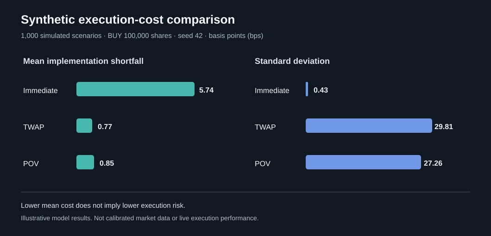

# Institutional Execution & Liquidity Simulator

**Python | Market Microstructure | Execution Cost Analysis | Monte Carlo**

An educational project that compares how an institutional **buy or sell order** might be executed using three simplified strategies: **Immediate**, **TWAP**, and **POV**. It evaluates **implementation shortfall**, fill rate, spread cost, an assumed market-impact penalty, timing risk, and incomplete-order opportunity cost across reproducible **synthetic** market scenarios.

> **Disclaimer:** All simulated prices, volumes, spreads, and liquidity are artificial. This project is **not** a live trading system, a calibrated market-impact model, a historical QQQ backtest, or evidence of real-world trading performance.

## The question

Suppose a client wants to buy **100,000 shares** of a liquid ETF-like instrument. Should the trading desk complete the trade immediately, spread it evenly through time, or trade at a fixed fraction of observed market volume?

There is a tradeoff: executing immediately avoids future price uncertainty but may incur substantial spread and impact costs. Executing over time can reduce the size of individual trades but exposes the order to price movement and potentially incomplete execution.

## Strategies

| Strategy | Simplified behavior | Principal tradeoff |
| --- | --- | --- |
| **Immediate** | Aggressively execute the entire order in the first time bucket | Larger modeled impact, lower timing uncertainty |
| **TWAP** | Split integer shares evenly across all time buckets | Smaller individual fills, exposure to price movement |
| **POV** | Trade at most 10% of simulated volume in each bucket | Adapts to market activity, might fail to complete |

The model compares all three strategies **on exactly the same market path within each simulation**. This paired design reduces noise when comparing strategies.

## Quick start

Requirements: Python 3.10+.

```bash
python -m pip install -r requirements.txt
python execution_simulator.py
```

Run tests:

```bash
python -m unittest -v
```

Alternative runs:

```bash
python execution_simulator.py --scenarios 2000 --seed 7
python execution_simulator.py --side sell --shares 50000
python execution_simulator.py --output-dir my_results
```

## Baseline assumptions

These are illustrative parameters, **not fitted from market data**.

| Parameter | Default |
| --- | ---: |
| Side / order size | Buy 100,000 shares |
| Initial synthetic midprice | $450.00 |
| Trading horizon | 20 time buckets |
| Midprice volatility | 12 bps per bucket |
| Drift | 0 bps per bucket |
| Typical bid-ask spread | 0.8 bps (full spread) |
| Typical market volume | 60,000 shares per bucket |
| Typical displayed liquidity scale | 12,000 shares |
| Assumed impact coefficient | 1.8 bps |
| POV participation target | 10% of bucket volume |
| Fee | $0.002 per executed share |
| Monte Carlo scenarios / seed | 1,000 / 42 |

Prices follow a zero-drift lognormal random-walk *illustration*. Spreads and volumes vary through independent lognormal factors; liquidity depth varies with volume. We do not calibrate them to a particular historical period.

### Simplified fill price

Let `side = +1` for a buy and `side = -1` for a sell. For each executed child order of size `q`:

```text
half_spread_dollars = mid * (spread_bps / 10_000) / 2
impact_dollars = mid * (impact_coefficient_bps / 10_000) * sqrt(q / depth)
fill_price = mid + side * (half_spread_dollars + impact_dollars)
```

This is an **assumed instantaneous execution-price penalty**, not a model of permanent impact on future midprices. It makes larger child orders relatively more expensive under the chosen assumptions.

### Implementation shortfall

The **arrival midprice** is the benchmark. For a buy, paying above the arrival mid is costly; for a sell, receiving less is costly.

```text
shortfall_$ = side * (filled_notional - filled_shares * arrival_mid)
              + fees
              + side * unfilled_shares * (terminal_mid - arrival_mid)

shortfall_bps = 10_000 * shortfall_$ / (order_shares * arrival_mid)
```

The last term accounts for the *mark-to-market opportunity cost of an unfinished order* using the final synthetic midprice. It can be negative when price movement is favorable. A negative implementation shortfall is possible; it does not imply guaranteed profit.

The code also decomposes implementation shortfall into:

- **Timing cost:** market midprice movement from arrival before individual fills.
- **Spread cost:** assumed half-spread paid by aggressive orders.
- **Impact cost:** assumed size/depth penalty.
- **Fees:** per-share execution charges.
- **Opportunity cost:** final-price mark for unfilled shares.

## Example output — baseline seed 42

Results from 1,000 simulated sessions, for the default **BUY 100,000** order:

| Strategy | Mean shortfall (bps) | Std. dev. (bps) | Mean fill | Incomplete scenarios |
| --- | ---: | ---: | ---: | ---: |
| Immediate | 5.736 | 0.430 | 100.000% | 0.0% |
| TWAP | 0.773 | 29.807 | 100.000% | 0.0% |
| POV | 0.847 | 27.261 | 99.804% | 5.2% |

**Interpretation:** Under this *specific artificial model*, TWAP and POV have lower *average* modeled costs than Immediate, but their outcomes vary substantially more because the order executes over time. POV sometimes fails to fill all shares. This is a tradeoff, not evidence that one method is universally superior.

### Cost distribution



The reproducible program also produces a full shortfall boxplot as `output/shortfall_boxplot.png` when run locally.

### Example path and fill prices

Run the simulator locally to generate the example market-path chart at `output/example_execution.png`.

The summary SVG is a visualization of the documented baseline results; the additional PNG charts and CSV files are generated by the Python program.

## Project files

```text
institutional-execution-simulator/
├── execution_simulator.py       # Main model and plotting code
├── test_simulator.py            # 8 unit tests
├── requirements.txt
├── INTERVIEW_PREP.md            # Questions and model explanations
├── WALKTHROUGH_HR.md            # Croatian step-by-step guide
├── README.md
├── .gitignore
└── output/
    ├── summary.csv
    ├── shortfall_summary.svg   # Baseline summary visualization
    ├── scenario_results.csv    # Generated when executed
    ├── example_path.csv        # Generated when executed
    ├── shortfall_boxplot.png    # Generated when executed
    └── example_execution.png   # Generated when executed
```

## Known limitations and next steps

1. **No real limit order book:** no queue priority, hidden liquidity, multiple price levels or real exchange matching.
2. **Synthetic data only:** spread, volatility, volume and depth assumptions may be unrealistic; there is no calibration or independent validation.
3. **No dynamic feedback:** our fills do not move the future synthetic midprice; the impact term is only a local price penalty.
4. **Bucket-level POV simplification:** this estimates execution as a fraction of volume realized *within the bucket*, as if participation occurs continuously as trades print. A real implementation needs event-level causality, volume observations, and order-routing constraints; it cannot know total future bucket volume in advance.
5. **No passive limit orders, auction mechanics, partial venue fills, latency or adverse selection.**
6. **Simplified risk metric:** opportunity cost is marked to terminal midprice and does not include a real forced-completion auction or delay beyond the horizon.
7. **No funding, taxes, borrow constraints or corporate actions.**

A logical next version would use historical intraday trades/quotes, calibrate spread/impact assumptions, introduce realistic order-book depth, and compare strategies on out-of-sample days. Such an upgrade must retain strict safeguards against look-ahead bias.

## Interview takeaway

The essential lesson is **execution quality is not just average execution price**. You have to consider order size relative to available liquidity, benchmark selection, timing risk, fees, incomplete fills, and how sensitive conclusions are to modeling assumptions.